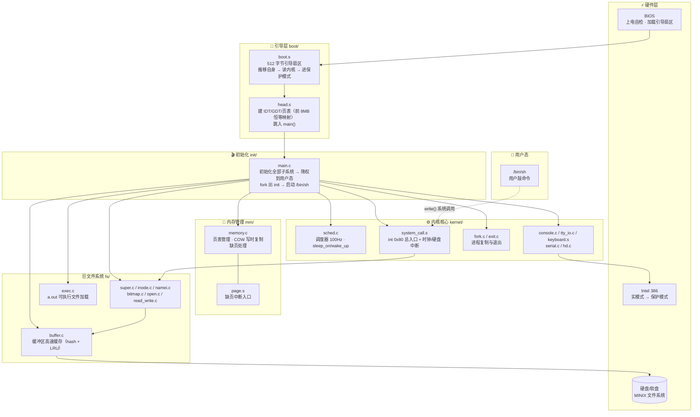
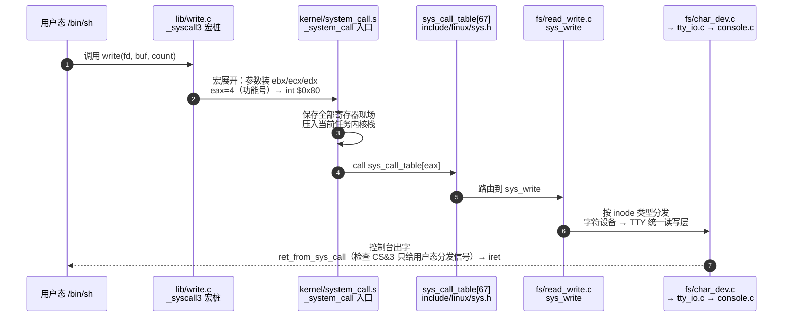

<div align="center">

# 🐧 Linux 0.01

**世界上最小的完整操作系统内核 —— 1991 年的第一版 Linux，约 11000 行代码，每一行你都能读懂**

*"Do you pine for the nice days of minix-1.1, when men were men and wrote their own device drivers?"* —— Linus Torvalds

[](./)
[-FCC624?style=flat-square&logo=linux&logoColor=black)](./ZHIDAO.md)
[](./STUDY_CHECKLIST.md)
[](./ZHIDAO.md)
[](./STUDY_CHECKLIST.md)
[](#-快速开始)
[](./LICENSE)

[快速开始](#-快速开始) · [架构总览](#%EF%B8%8F-架构总览) · [核心机制](#-核心机制亮点) · [配套文档](#%EF%B8%8F-配套学习文档) · [学习路线](#%EF%B8%8F-学习路线建议)

</div>

---

## 📖 项目简介

1991 年 8 月 25 日，21 岁的 Linus Torvalds 在 comp.os.minix 上发帖："I'm doing a (free) operating system (just a hobby, won't be big and professional...)"。这个"业余爱好"的第一份代码就是 **Linux 0.01**——约 **10,000 行** C 和 x86 汇编。

它不是现代 Linux 发行版，而是**一个操作系统的全部骨架**：从按下电源到出现 shell 提示符的每一步，都能在这 1 万行里找到答案。现代 Linux 内核超过 3000 万行，而它的祖先靠这 1 万行就能开机、跑 shell、执行命令——**骨架完整，血肉可以慢慢长**。

本仓库在原版源码之上提供了三样配套学习工具：

| 配套产物                                 | 定位                                                                                                | 适合谁                             |
| ---------------------------------------- | --------------------------------------------------------------------------------------------------- | ---------------------------------- |
| [ZHIDAO.md](ZHIDAO.md)                   | 🗺️ **项目地图**：10 章中文导读（核心概念 → 运行流程 → 逐文件导读 → 复刻路线 → FAQ）                  | 想建立全局心智、按图索骥的读者     |
| [STUDY_CHECKLIST.md](STUDY_CHECKLIST.md) | ✅ **逐页书签**：83 个源文件全覆盖、四级分级（⭐⭐/⭐/·/○）、每文件可打勾 + 自检题                      | 被项目规模吓退、想逐个推进的学习者 |
| 源码内中文注释                           | 📝 **意图级批注**：每个分支/调用/关键赋值都有"为什么存在"的解释，保留 Linus 原版英文注释并在其上叠加 | 逐行精读的读者                     |

**读代码前的硬约束**（1991 年的物理世界，读代码时处处会碰到）：

| 约束       | 数值                           | 影响                                             |
| ---------- | ------------------------------ | ------------------------------------------------ |
| 目标 CPU   | Intel 386 保护模式             | 代码里全是 GDT/LDT/TSS/页表这些 386 术语         |
| 内存上限   | 8 MB（`HIGH_MEMORY=0x800000`） | 页表只建 2 页（pg0/pg1），够映射 8MB             |
| 编译器     | gcc 1.40（1991 年版）          | 只认 C89，注释必须 `/* */`，现代机器无法直接编译 |
| 文件系统   | MINIX FS                       | inode 32 字节、块 1KB、文件名最长 14 字符        |
| 任务数上限 | 64 个（`NR_TASKS`）            | `task[]` 数组硬编码 64 项                        |
| 系统调用   | 67 个（0~66）                  | `sys_call_table` 有 67 个表项，多数是空壳        |

> 💡 **30 秒听懂它做了什么**：多进程（fork/exit/wait）、分页内存管理 + COW 写时复制、MINIX 文件系统读写、控制台/键盘/串口/硬盘驱动、雏形信号机制。它**没有**网络、动态链接和 swap——那些是后来 30 年长出的血肉。

---

## 🏗️ 架构总览



**从上电到 shell 的六段旅程**：

```
① BIOS 加载 boot.s 到 0x7C00 → ② boot.s 把内核读到内存、进入保护模式
③ head.s 建页表和中断表 → ④ main.c 初始化全部子系统并降权
⑤ fork 出 init：挂载根文件系统、启动 /bin/sh → ⑥ 用户敲命令 → int 0x80 → 屏幕出字
```

---

## ✨ 核心机制亮点

### 🚪 一条 write 命令的完整旅程（int 0x80 系统调用全链路）



### 🧬 更多值得精读的机制（每个都有确切落点）

- 🧬 **任务切换只有一条 `ljmp`** — `switch_to` 宏长跳转到目标进程的 TSS 段，CPU 硬件自动交换全部寄存器现场，没有任何手工保存/恢复代码（`kernel/sched.c` + `include/asm/system.h`）
- 📄 **COW 写时复制雏形** — 父子进程先共享物理页并标记只读，谁写谁挨缺页中断，中断处理程序再复制新页（`mm/memory.c` 的 `do_wp_page` + `mm/page.s` 缺页入口）
- 🚪 **67 个系统调用一张函数指针表** — `_syscallN` 宏用 C 预处理器生成完整系统调用桩，`sys_call_table` 完成功能号到内核函数的分发（`include/unistd.h` + `kernel/system_call.s`）
- 📦 **task_struct 与内核栈共居一页** — `union task_union` 让"人事档案"和"工作台"同页存放，切换任务时整页带走，天然隔离各进程内核栈（`include/linux/sched.h` + `kernel/fork.c`）
- 🧱 **Buffer Cache：hash 表 + 双向空闲链** — 磁盘块缓存三件套 `getblk/hash/find_buffer`，按 LRU 精神腾位置（`fs/buffer.c`）
- 🛗 **电梯排序的硬盘请求队列** — `do_hd_request` 按块号顺序处理请求，减少磁头来回摆动（`kernel/hd.c`）
- 🕐 **100Hz 时钟滴答记账** — 8253 定时器每 10ms 一次中断，`do_timer` 扣减时间片并按"衰减公式"隐性奖励 IO 密集型进程（`kernel/sched.c`）
- 🖥️ **VT102 转义序列解析器** — 纯状态机实现 ANSI 控制序列，1991 年的终端美学（`kernel/console.c`）
- 🎯 **fork"一次调用两次返回"** — `copy_process` 里把子进程的 `tss.eax` 强制清零，父子从同一条指令继续但各持不同返回值（`kernel/fork.c`）

---

## 📁 项目结构

```
linux-0.01/
├── boot/                 # 🔌 引导阶段（汇编，最先执行）
│   ├── boot.s            #    512 字节引导扇区：被 BIOS 加载，装载内核、进保护模式
│   └── head.s            #    32 位起步代码：建 IDT/GDT/页表，跳入 main()
├── init/                 # 🎬 内核 C 入口
│   └── main.c            #    初始化全部子系统 → 降权 → fork 出 init
├── kernel/               # ⚙️ 内核核心（调度 / 系统调用 / 驱动全在这）
│   ├── sched.c           #    调度器总纲：schedule() / sleep_on / do_timer
│   ├── system_call.s     #    int 0x80 总入口 + 时钟中断 + 硬盘中断
│   ├── fork.c / exit.c   #    进程复制（copy_process）与退出回收
│   ├── sys.c / traps.c   #    简单系统调用集合 / CPU 异常处理登记
│   └── console.c / tty_io.c / keyboard.s / serial.c / hd.c
│                         #    控制台 / 终端 / 键盘 / 串口 / 硬盘驱动
├── mm/                   # 🧠 内存管理
│   ├── memory.c          #    分页核心：get_free_page / 页表复制 / COW 缺页
│   └── page.s            #    缺页中断低级入口
├── fs/                   # 🗄️ MINIX 文件系统（18 个文件）
│   ├── namei.c           #    路径解析（全内核最大文件，678 行）
│   ├── inode.c / buffer.c #   inode 缓存 / 缓冲区高速缓存
│   ├── exec.c            #    a.out 可执行文件加载
│   └── open.c / read_write.c / pipe.c / super.c / bitmap.c …
├── include/              # 📚 头文件字典（29 个：sched.h / fs.h / unistd.h …）
├── lib/                  # 🧰 系统调用桩函数库（write / open / wait …）
├── tools/                # 🔨 build.c：宿主机上的 Image 拼装器
├── ZHIDAO.md             # 🗺️ 中文导读：10 章项目地图（先读这个）
├── STUDY_CHECKLIST.md    # ✅ 逐文件精读打卡清单（83 文件全覆盖）
└── Makefile              # 1991 年原版构建（gcc 1.40 工具链，现代机器不可直接编译）
```

<details>
<summary><b>📂 完整 83 文件清单与四级分级（点击展开）</b></summary>

全部源文件的必读标记、功能说明、阅读顺序与自检题，见 [STUDY_CHECKLIST.md](STUDY_CHECKLIST.md)。快速结论：

| 层级         | 数量 | 代表文件                                                                                                        |
| ------------ | ---- | --------------------------------------------------------------------------------------------------------------- |
| ⭐⭐ 必读·核心 | 9    | `sched.c` · `system_call.s` · `fork.c` · `memory.c` · `namei.c` · `buffer.c` · `inode.c` · `exec.c` · `sched.h` |
| ⭐ 必读       | 22   | `boot.s` · `head.s` · `main.c` · `exit.c` · `sys.c` · `console.c` · `tty_io.c` · `hd.c` · `page.s` …            |
| · 选读       | 16   | `pipe.c` · `vsprintf.c` · `printk.c` · `mktime.c` …                                                             |
| ○ 薄文件     | 39   | `lib/` 全部 · `include/` 多数常量与声明头                                                                       |

</details>

> 🗺️ **逐文件深度导读（每个文件讲什么、为什么这么写、阅读顺序）见 [ZHIDAO.md](ZHIDAO.md)**

---

## 🚀 快速开始

### 0️⃣ 环境准备

读这个项目**零依赖**——它是源码精读仓库，不是可构建软件：

| 用途                 | 要求                                                                                                    | 说明                                            |
| -------------------- | ------------------------------------------------------------------------------------------------------- | ----------------------------------------------- |
| 只读精读（推荐起点） | 任意编辑器/IDE                                                                                          | VS Code / CLion / vim 均可，配合 ZHIDAO.md 阅读 |
| 实机运行（可选）     | QEMU（Windows 从 [qemu.org](https://www.qemu.org/download/) 下载；Linux `apt install qemu-system-x86`） | 跑现成历史镜像，10 分钟见效                     |
| 现代重编译（进阶）   | gcc 3.x/4.x + bin86 + 社区移植补丁                                                                      | 原版 Makefile 面向 gcc 1.40，需打补丁           |

### 1️⃣ 获取代码

```bash
git clone <本仓库地址> linux-0.01
cd linux-0.01
```

### 2️⃣ 建立全局心智（约 1 小时）

按顺序读 [ZHIDAO.md](ZHIDAO.md) 的第 1~4 章：项目是什么 → 7 个核心概念 → 目录结构 → 运行流程全景图。读完你会拿到一张"内核地图"，之后逐文件精读时随时回来查。

### 3️⃣ 开始逐文件精读

打开 [STUDY_CHECKLIST.md](STUDY_CHECKLIST.md)，按四级分级（⭐⭐ → ⭐ → · → ○）和三条精读路径推进，每读完一个文件打一个勾：

- 🚀 **速览路径**（3~4 天，面试/考试前）：只读 ⭐⭐ 文件，能讲清"启动六阶段、调度公式、int 0x80 全链路、COW 四步、MINIX 五层楼"五件事
- 🛤 **主线路径**（8~10 天，推荐）：全部 ⭐⭐ + ⭐ 打勾，目标是从上电到 shell 讲一遍不留断点
- 🏔 **全量路径**（14+ 天）：83 文件全打勾 + 口答全部自检题 + 完成最小复刻

### 4️⃣ （可选）让它真的跑起来

<details>
<summary><b>路径 A：QEMU 跑现成镜像（推荐，10 分钟见效）</b></summary>

1. 安装 QEMU；
2. 从 [oldlinux.org](http://www.oldlinux.org/) 等存档站获取已构建好的 linux-0.01 引导镜像 + MINIX 根文件系统镜像；
3. 运行：

```bash
qemu-system-i386 -fda bootimage -hda minix.rootimage -boot a
```

4. 验收：看到 `Loading system...` → `Partition table ok` → shell 提示符，敲 `ls` 能列出目录，说明这 1 万行的链路全部活着。

</details>

<details>
<summary><b>路径 B：现代工具链重编译（进阶，需打补丁）</b></summary>

gcc 1.40 早已绝迹。GitHub 上有多个 `linux-0.01-compilable` 项目提供了用 gcc 3.x/4.x + bin86 编译通过的补丁集，思路是：`as86/ld86` 换成 bin86 包（现代发行版仍可安装），C 代码补 `volatile`、修复原型告警。`tools/build.c` 是宿主机程序，用现代 gcc 直接编译没问题。

</details>

<details>
<summary><b>路径 C：只读精读 + 手绘（零环境成本）</b></summary>

按 ZHIDAO 第 9 章路线精读，配一张纸手绘：BIOS→main 的栈变化图、fork 时页表变化图、COW 缺页时序图。读内核最大的成本不是跑不起来，而是"以为自己懂了"。

</details>

### 5️⃣ 验收测试点

无论哪条路径，这些现象都能对应回具体代码——现象与代码对上号，才叫真的读懂：

| 现象                                   | 对应代码                                               |
| -------------------------------------- | ------------------------------------------------------ |
| 屏幕左上角 `Loading system ...`        | `boot/boot.s`：msg1 + int 0x10                         |
| 无数个小白点闪烁                       | `boot/head.s`：ignore_int（未注册中断被触发）          |
| `Partition table ok.`                  | `kernel/hd.c`：sys_setup                               |
| `xxx buffers = xxx bytes buffer space` | `init/main.c`：init()                                  |
| shell 提示符与回显                     | `kernel/console.c` + `kernel/tty_io.c`：copy_to_cooked |
| Ctrl-Alt-Del 重启                      | `kernel/keyboard.s`：cursor → reboot                   |

---

## 🗺️ 学习路线建议

```
第 0 步  ZHIDAO 第 1~4 章            → 建立全局心智（~1 小时）
第 1 步  boot/boot.s + head.s + init/main.c
                                     → 吃透启动链：从 BIOS 到 main 的六段旅程
第 2 步  sched.h + sched.c + system_call.s + fork.c
                                     → 吃透进程与调度：task_union / switch_to / int 0x80
第 3 步  mm/memory.c + page.s        → 吃透分页与 COW：页表复制 / 缺页处理
第 4 步  fs 四大件：buffer.c / inode.c / namei.c / exec.c
                                     → 吃透文件系统：缓存 / 三级块映射 / 路径解析 / a.out 加载
第 5 步  挑一个你最感兴趣的驱动      → console / keyboard / hd 都是好教材
第 6 步  ZHIDAO 第 9 章：提笔复刻    → boot.s 起步 → 双进程轮流打印 A/B
```

- 📚 精读工具：[STUDY_CHECKLIST.md](STUDY_CHECKLIST.md)（每文件打勾 + 自检题）
- 🗺️ 路线详情：[ZHIDAO.md 第 9 章](ZHIDAO.md)（复刻三阶段 + 学习资源表）

---

## 🧭 Roadmap

- [x] ✅ ZHIDAO.md 中文导读（10 章项目地图）
- [x] ✅ STUDY_CHECKLIST.md 逐文件精读打卡清单（83 文件全覆盖）
- [x] ✅ 启动链 / 调度 / 内存 / fs 核心 25 个文件的意图级中文注释
- [ ] ⬜ 全部 83 个源文件补齐意图级中文注释
- [ ] ⬜ 现代工具链（gcc + bin86）编译适配补丁
- [ ] ⬜ QEMU 一键启动脚本
- [ ] ⬜ 最小复刻实验：boot → main → 双进程轮流打印

---

## 🤝 致谢与许可

- 感谢 **Linus Torvalds** 在 1991 年开源了这份骨架完整的 1 万行代码；
- 中文注释与导读编写过程参考了赵炯《Linux 内核完全注释》与 [oldlinux.org](http://www.oldlinux.org/) 的历史存档；
- 本仓库整理与注释部分遵循 [MIT License](./LICENSE)。

<div align="center">

**如果这份"操作系统的第一张施工图"对你有帮助，欢迎 Star ⭐ 支持！**

</div>
